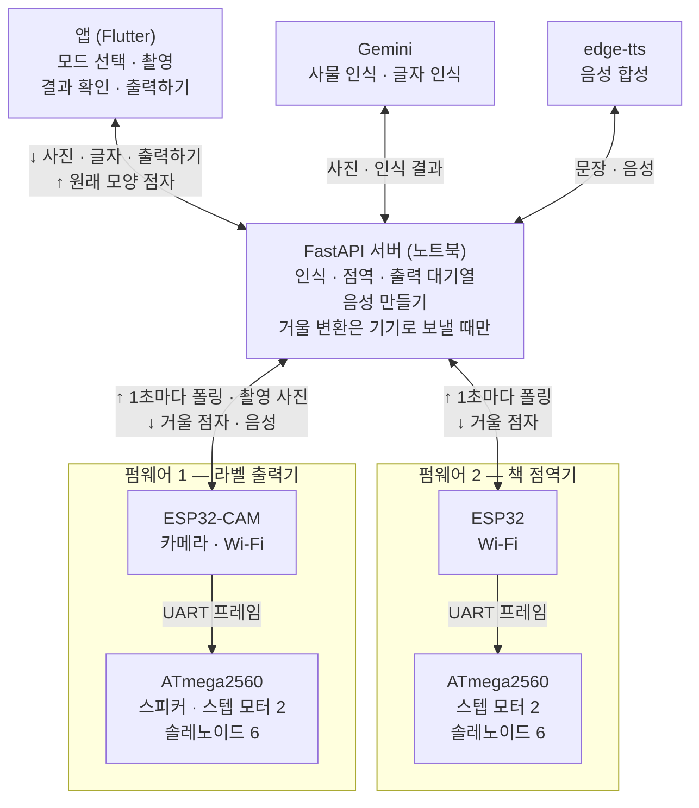

# Eye 2 Dot

**AI 사물 인식을 활용한 점자 라벨 출력기 및 책 점역기**

2026 동국대학교 전자전시회 · 윤재민 · 윤준석 · 박세연 · 전혁진

## 무엇을 하나

사진 한 장을 찍으면 AI(Gemini)가 무엇이 찍혔는지 알아내고, 그 결과를 점자로 찍어 주는 시각장애인용 시스템이다.
사진은 앱으로 찍거나 고르고, 라벨 출력기는 기기에 달린 카메라로도 찍는다.

- **라벨 모드**: 사물 사진 → Gemini 가 사물 이름을 인식 → 점자 라벨 카드(한 줄, 최대 15칸) + 음성 안내 (펌웨어 1, 라벨 출력기)
- **책 모드**: 책 페이지 사진 → 본문 글자 인식(OCR) → A4 점자 (한 장 25줄, 한 줄 30칸. 펌웨어 2, 책 점역기)

## 시스템 구조



- 선 위 글의 ↑·↓ 는 그 내용이 그림에서 가는 방향이다 (앱은 서버 위, 기기는 서버 아래).
- 앱은 원래 모양의 점자를 받아 보여 주고, "출력하기"를 누르면 서버의 출력 대기열에 넣는다.
- 서버와 기기 사이의 요청은 **항상 기기가 먼저 보낸다**. 두 기기의 ESP32 는 할 일이 없을 때 **1초마다 서버에 물어서**(폴링) 작업을 가져가고,
  음성도 ESP32 가 서버에 요청해 받는다. 서버가 기기를 먼저 부르지 않는다.
  라벨 출력기는 기기의 촬영 버튼으로 사진을 바로 보내 결과를 받을 수도 있다.
- 점자를 **거울 모양**(칸 안의 좌우를 바꾼 값)으로 바꾸는 일은 **서버만** 한다. 기기는 받은 값을 뒤집지 않고 그대로 찍는다.
  이유와 약속은 [`docs/api-spec.md`](docs/api-spec.md) "기기로 보내는 점자는 거울 모양".
- 기기 안에서는 ESP32 가 서버 통신을 맡고, ATmega2560 이 모터·솔레노이드를 맡는다. 두 칩은 UART(전선 2가닥으로 바이트를 주고받는 방식)로 프레임을 주고받는다.

## 빠른 시작

### 1. 서버

먼저 `server/.env` 에 Gemini API 키를 넣는다 (아래 "비밀값"). 키가 없으면 서버가 켜지지 않는다.
Python 3.14 에서 개발했다 ([`server/requirements.txt`](server/requirements.txt)).

```bash
# 처음 한 번 (저장소 루트에서, Windows Git Bash 기준)
python -m venv .venv
source .venv/Scripts/activate
pip install -r server/requirements.txt

# 서버 켜기
cd server
uvicorn main:app --host 0.0.0.0 --port 8000
```

- `--host 0.0.0.0` 이 없으면 기기가 서버에 접속하지 못한다.
- 브라우저에서 `http://localhost:8000/health` 가 열리면 켜진 것이다. 출력 대기열은 `/jobs`.
- 켜질 때 노트북 IP 와 갤럭시탭 접속 주소를 출력한다. 이 IP 는 펌웨어 `secrets.h` 의 서버 IP 와 같아야 한다.
- 음성을 만들려면 서버 컴퓨터가 인터넷에 연결되어 있어야 한다 (edge-tts).
- 주소와 응답 형식 전체는 [`docs/api-spec.md`](docs/api-spec.md).

### 2. 앱

서버를 켠 같은 PC 에서 Chrome 으로 띄운다 (서버 주소 `localhost` 기준).

```bash
cd app
flutter pub get
flutter run -d chrome
```

서버 주소를 정하는 규칙과 화면 흐름은 [`app/README.md`](app/README.md),
갤럭시탭 Chrome 으로 시험·시연하는 순서는 [`docs/tablet-manual.md`](docs/tablet-manual.md).

### 3. 펌웨어

PlatformIO 프로젝트 네 개다. 올릴 프로젝트 폴더로 들어가서 빌드·업로드한다.

| 폴더 | 보드 | PlatformIO 환경 | 먼저 할 것 |
|---|---|---|---|
| [`firmware1/mega/`](firmware1/mega/) | Arduino Mega 2560 | `mega` | — |
| [`firmware1/cam/`](firmware1/cam/) | ESP32-CAM (AI Thinker) | `esp32cam` | `include/secrets.h` 만들기 |
| [`firmware2/mega/`](firmware2/mega/) | Arduino Mega 2560 | `mega` | — |
| [`firmware2/esp/`](firmware2/esp/) | ESP32 개발 보드 (WROOM-32D) | `esp32dev` | `include/secrets.h` 만들기 |

```bash
cd firmware1/mega        # 올릴 프로젝트 폴더
pio run                  # 빌드
pio run -t upload        # 업로드
pio device monitor       # 시리얼 모니터 (115200)
```

- **업로드할 때는 배터리를 빼고 USB 만 꽂는다** (업로드 중 솔레노이드가 켜지지 않게).
- 배선, 부품 하나씩 시험하는 순서, 조립 뒤 맞출 숫자는 [`firmware1/README.md`](firmware1/README.md), [`firmware2/README.md`](firmware2/README.md).

## 하드웨어

| | 펌웨어 1 — 라벨 출력기 | 펌웨어 2 — 책 점역기 |
|---|---|---|
| 서버 통신 | ESP32-CAM (AI Thinker) — 카메라, Wi-Fi | ESP32 개발 보드 (WROOM-32D) — Wi-Fi |
| 기구 제어 | ATmega2560 (Arduino Mega 2560) | ATmega2560 (Arduino Mega 2560) |
| 스텝 모터 | 28BYJ-48 (5V) + ULN2003 보드 × 2 — 헤드, 카드 공급 랙 | 17HS3430 (NEMA17) + A4988·DRV8825 계열 드라이버 × 2 — 헤드 가로(X), 종이판 세로(Y) |
| 타각 | 솔레노이드 6개 (L298N 2개), 한 칸의 점을 동시에 찍음 | 솔레노이드 6개 (L298N 2개), 한 칸을 두 번 누름 |
| 소리 | 스피커 + LM386 앰프 — 음성 안내, 알림음 | 능동 부저 (선택) |
| 입력 | 촬영·출력 버튼, 헤드 원점 스위치, 카드 감지 센서 (선택) | "출력 계속" 버튼, 원점 스위치 2개 |
| 전원 | 18650 × 3 (11.1V) → 퓨즈 → 스위치 → L298N · Mega VIN · LM2596 5V (ESP32-CAM, LM386, ULN2003) | 18650 × 3 (11.1V) |
| 출력물 | 라벨 카드 (가로 100mm, 한 줄 최대 15칸) | A4 (한 장 25줄, 한 줄 30칸) |

핀 번호와 배선은 [`firmware1/README.md`](firmware1/README.md) "배선", [`firmware2/README.md`](firmware2/README.md) "핀 (Mega)".

## 현재 상태

### 다 된 것

- **서버**: 사진 인식(Gemini), 점역, 거울 변환, 음성, 출력 대기열이 모두 들어 있다. 실제 Gemini 키로 인식을 확인했다.
- **앱**: 모드 선택 → 촬영·사진 고르기·라벨 문구 직접 입력 → 결과 확인 → 출력하기(`POST /print`).
  서버가 앱 화면도 띄워 주므로 태블릿·휴대폰 Chrome 으로 설치 없이 쓴다 — [`app/README.md`](app/README.md) "태블릿·휴대폰 브라우저로 쓰기".
- **펌웨어 빌드**: 네 프로젝트와 부품 시험 프로그램이 PlatformIO 로 빌드된다.
- **PC 모의 시험**: 보드 없이 두 펌웨어의 실제 코드를 PC 에서 돌리는 시험(`tests/host_sim`)을 모두 통과했다.
  실행 방법은 [`firmware1/tests/host_sim/README.md`](firmware1/tests/host_sim/README.md), [`firmware2/tests/host_sim/README.md`](firmware2/tests/host_sim/README.md).
- **실물**: 솔레노이드 6개 동작 (2026-11-07, 시험 스케치).
  펌웨어 2 Mega 에 부품별 시험 프로그램([`firmware2/tests/mega_bench/`](firmware2/tests/mega_bench/))을 올려 명령 목록이 나오는 것까지 확인했고,
  지금 브레드보드에 부품을 하나씩 연결하며 시험하고 있다.

### 시험 전

실물 보드에서 아직 돌려 보지 않은 것이다.

- 펌웨어 1: 스텝 모터(28BYJ-48 + ULN2003) 구동, 스피커 음성 재생, ESP32-CAM 촬영 → 서버 전송, ESP32-CAM ↔ ATmega2560 UART 통신
- 펌웨어 2: ESP32 ↔ ATmega2560 UART 통신, 모터·원점 스위치·타각을 기구에 물려 돌리기
- 앱 → 서버 → 기기 전체 흐름
- 갤럭시탭 Chrome 에서 앱 실행
- 조립 뒤 실측해 맞출 숫자 (펌웨어 1 `mega/include/motion.h`, 펌웨어 2 `mega/include/config.h`). 지금은 설계값이고, 맞추는 순서는 각 펌웨어 README.

### 남은 과제

- **펌웨어 1**: 찍힌 카드 내보내기, 배터리 부족 감지, ESP32 부팅 완료 알림 등 — [`firmware1/README.md`](firmware1/README.md) "남은 일".

## 폴더 지도

| 폴더 | 무엇 | 먼저 읽을 문서 |
|---|---|---|
| [`app/`](app/) | Flutter 앱 — 모드 선택, 촬영·사진 고르기·라벨 문구 직접 입력, 결과 확인, 출력하기 | [`app/README.md`](app/README.md) |
| [`server/`](server/) | FastAPI 서버 — Gemini 인식, 점역(`braille.py`), 거울 변환(`mirror.py`), 음성(`speech.py`·`speech_store.py`), 출력 대기열(`jobs.py`) | [`docs/api-spec.md`](docs/api-spec.md) (설치·실행 포함) |
| [`firmware1/`](firmware1/) | 펌웨어 1 라벨 출력기 — ESP32-CAM(`cam/`) + ATmega2560(`mega/`), 부품 시험 프로그램(`tests/`) | [`firmware1/README.md`](firmware1/README.md) |
| [`firmware2/`](firmware2/) | 펌웨어 2 책 점역기 — ESP32(`esp/`) + ATmega2560(`mega/`), 부품 시험 프로그램(`tests/`). A4 한 장에 25줄 × 30칸 | [`firmware2/README.md`](firmware2/README.md) |
| [`docs/`](docs/) | API·통신 규격, 태블릿 시험·시연 매뉴얼 | 아래 "기준 문서" |

## 기준 문서

같은 내용을 여러 곳에 적지 않는다. 바꿀 때는 아래 기준 문서를 고치고, 다른 문서는 그곳을 가리키게 한다.

| 내용 | 기준 |
|---|---|
| 서버 HTTP 주소, 응답 형식, 음성 형식, 거울 약속, 라벨 길이 제한 | [`docs/api-spec.md`](docs/api-spec.md) |
| 폴링(`/print`, `/jobs`), 음성 받기 규칙, 펌웨어 1 의 두 칩(ESP32-CAM ↔ ATmega2560) 사이 프레임의 모양과 순서 | [`docs/POLLING_API.md`](docs/POLLING_API.md) |
| 펌웨어 1 시리얼 값 (통신 속도, 프레임 번호, 크기·시간 한도) | [`firmware1/common/protocol.h`](firmware1/common/protocol.h) |
| 펌웨어 2 시리얼 약속 (통신 속도, 프레임 종류, 한 장의 줄 수·한 줄의 칸 수, 상태·오류 코드) | [`firmware2/common/protocol.h`](firmware2/common/protocol.h) |
| 펌웨어 1 사용법, 배선, 시험 방법, 조정값 | [`firmware1/README.md`](firmware1/README.md) |
| 펌웨어 2 사용법, 배선, 시험 방법, 조정값 | [`firmware2/README.md`](firmware2/README.md) |
| 태블릿(갤럭시탭 Chrome) 시험·시연 순서, 시연 전 점검표, 문제 해결 | [`docs/tablet-manual.md`](docs/tablet-manual.md) |

## 비밀값 — git 에 올리지 않는 파일

아래 파일은 `.gitignore` 에 들어 있어 커밋되지 않는다. 각자 컴퓨터에서 만든다.

| 파일 | 내용 | 만드는 법 |
|---|---|---|
| `server/.env` | Gemini API 키 | `server/` 에 `.env` 를 만들고 `GEMINI_API_KEY=발급받은_키` 한 줄. 없으면 서버가 켜지지 않는다 |
| `firmware1/cam/include/secrets.h` | Wi-Fi 이름·비밀번호, 서버(노트북) IP | 같은 폴더의 `secrets.example.h` 를 `secrets.h` 로 복사해 채운다 |
| `firmware2/esp/include/secrets.h` | 위와 같음 (펌웨어 2 용) | 위와 같음 |
| `firmware2/tests/esp32_net_check/include/secrets.h` | 위와 같음 (통신 확인 프로그램용) | 위와 같음 |

- `secrets.h` 가 없으면 그 프로젝트의 빌드가 멈춘다.
- **견본 파일(`secrets.example.h`)에는 진짜 값을 넣지 말 것.** 견본은 git 에 올라간다.
- 비밀은 아니지만 컴퓨터마다 다른 `upload_ports.ini`(펌웨어 1 의 COM 포트 지정), `*.code-workspace`(VS Code 작업공간)도 올리지 않는다.

## 라이선스

MIT — [`LICENSE`](LICENSE)
