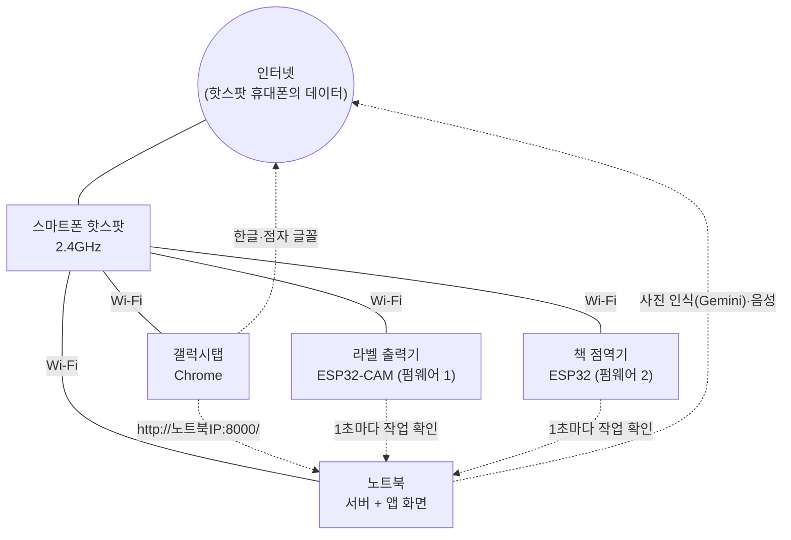

# 태블릿 시험·시연 매뉴얼

`feature/app/mobile` branch 기준이다. 이 branch 는 아직 main 에 합쳐지지 않은 시험용이다.
명령은 모두 **Windows Git Bash** 기준이고, 그대로 복사해 쓸 수 있다. `[확인 필요]` 는 아직 실물로 확인하지 못한 내용이다.

## 0. 이 문서가 다루는 것

- 갤럭시탭 **Chrome** 으로 앱 쓰기. 앱을 설치하지 않고, 노트북 서버가 띄워 주는 앱 화면(`http://<노트북 IP>:8000/`)을 연다.
- 네트워크는 **팀원 스마트폰 핫스팟** 하나. 노트북·갤럭시탭·ESP32 2대가 모두 여기에 붙고, 노트북은 핫스팟으로 인터넷도 쓴다.



- 실선은 Wi-Fi 연결, 점선은 누가 누구에게 요청하는지다.
- 노트북 IP 는 고정이 아니다. 핫스팟이 바뀌면 달라질 수 있다. 서버를 켤 때 로그에 나오는 IP 를 본다.
- 두 ESP32 는 `secrets.h` 에 적힌 IP 로 서버를 찾는다. 그래서 **노트북 IP 가 바뀌면 펌웨어도 다시 올려야 한다** (4장).

## 1. 처음 한 번 준비

### 1-1. branch 받기

```bash
cd /c/dev/eye2dot          # 자기 저장소 폴더 (경로는 각자 다를 수 있다)
git status                 # "nothing to commit" 이어야 한다. 고친 파일이 있으면 먼저 커밋해 둔다
git fetch origin           # GitHub 의 최신 정보 받기 (내 파일은 바뀌지 않는다)
git checkout feature/app/mobile
git pull
```

- `git checkout` 은 "지금 보는 branch 바꾸기"다. main 으로 돌아갈 때는 `git checkout main`.
- **VS Code 왼쪽 아래**(상태 표시줄)에 branch 이름이 보인다. `feature/app/mobile` 이면 맞다. 눌러서 다른 branch 로 바꿀 수도 있다.

### 1-2. Python 가상환경과 패키지

가상환경(`.venv`)은 이 프로젝트 전용 Python 패키지 상자다. 루트 [`README.md`](../README.md) "빠른 시작 → 1. 서버"와 같다.

```bash
# 저장소 루트에서, 처음 한 번
python -m venv .venv
source .venv/Scripts/activate
pip install -r server/requirements.txt
```

- Git Bash 창을 새로 열 때마다 `source .venv/Scripts/activate` 를 다시 한다. 줄 앞에 `(.venv)` 가 보이면 켜진 것이다.

### 1-3. Flutter 패키지

```bash
cd app
flutter pub get
cd ..
```

### 1-4. `server/.env`

`server` 폴더에 `.env` 파일을 만들고 한 줄을 적는다. **git 에 올리지 않는다** (`.gitignore` 에 들어 있다).

```
GEMINI_API_KEY=발급받은_키
```

없으면 서버가 켜지지 않고 `.env 파일에 GEMINI_API_KEY가 없습니다` 오류가 난다.

### 1-5. Windows 방화벽 — 공용 네트워크에서도 Python 허용

방화벽이 막으면 갤럭시탭·ESP32 가 노트북 서버에 접속하지 못한다. Windows 는 스마트폰 핫스팟을 **"공용 네트워크"** 로 잡는 경우가 많아서, 공용에서도 허용해야 한다.

- **처음 서버를 켤 때 "Windows 보안 경고" 창이 뜨면**: "개인 네트워크"와 **"공용 네트워크"** 둘 다 체크 → "허용"(Windows 10 은 "액세스 허용").
- **이미 창을 닫았거나 공용을 체크하지 않았다면**:
  1. 시작 → "Windows 보안" → "방화벽 및 네트워크 보호" → "방화벽에서 앱 허용"
  2. "설정 변경" → 목록에서 **Python** 을 찾아 "공용" 칸 체크 (Python 이 여러 줄이면 모두) → 확인
- 다른 방법: 핫스팟을 "개인 네트워크"로 바꾼다. 설정 → 네트워크 및 인터넷 → Wi-Fi → (연결된 핫스팟 이름) → 네트워크 프로필 유형 → "개인 네트워크".

## 2. 시험 A — 노트북 혼자 (핫스팟 없이)

집·학교 Wi-Fi 든 무엇이든 노트북만 있으면 된다. Git Bash 창을 **두 개** 쓴다.

### A-1. 예전 방식: `flutter run -d chrome`

```bash
# 창 1: 서버 (저장소 루트에서)
source .venv/Scripts/activate
cd server
uvicorn main:app --host 0.0.0.0 --port 8000
```

```bash
# 창 2: 앱 (저장소 루트에서)
cd app
flutter run -d chrome
```

Chrome 이 열리면 아래를 차례로 해 본다. PC 에서는 "카메라로 촬영하기"를 눌러도 파일 고르는 창이 열리므로, 사진 파일을 미리 준비해 둔다.

- [ ] **라벨 사진**: "점자 라벨 만들기" → "앨범에서 사진 선택하기" → 물건 사진 → 결과 화면에 이름과 점자
- [ ] **직접 입력**: "점자 라벨 만들기" → "라벨 문구 직접 입력하기" → `우유` → 확인 → 결과 화면
- [ ] **책 사진**: "책 점역하기" → "앨범에서 사진 선택하기" → 책 페이지 사진 → 본문, 점자, "전체 N칸 · M줄"
- [ ] **출력하기**: 결과 화면 "출력하기" → 아래 알림이 뜨고, 서버 로그에 `[대기열] …` 줄이 생긴다
  - 라벨: `라벨 출력기로 보냈어요. 기기에서 안내를 듣고 출력 버튼을 눌러 주세요 (대기 중인 작업 1개)`
  - 책: `책 점역기로 보냈어요 (대기 중인 작업 1개)`

기기가 꺼져 있으면 작업은 대기열에 쌓이기만 한다. 서버를 다시 켜면 대기열은 비워진다.

### A-2. 서버가 띄운 앱 화면: `http://localhost:8000/`

```bash
# 창 2 에서 (A-1 의 flutter run 은 q 로 끈다)
cd app                                   # 이미 app 폴더면 생략
flutter build web --no-web-resources-cdn   # 1분쯤 걸린다
```

- `--no-web-resources-cdn`: 화면을 그리는 엔진 파일을 인터넷(CDN) 대신 노트북 서버에서 받게 하는 옵션.
- **서버를 켠 뒤에 처음 빌드했다면 서버를 껐다 다시 켠다.** 서버는 앱 화면(`app/build/web`)이 있는지를 켤 때 한 번만 본다.
  이미 앱 화면이 있는 상태에서 켠 서버라면, 다시 빌드한 뒤 브라우저 새로고침만 하면 된다.

Chrome 에서 `http://localhost:8000/` 을 열고 A-1 과 같은 순서로 해 본다.

### A-3. 서버 로그에서 확인할 줄

서버를 켜면 맨 위에 이렇게 나온다 (`192.168.x.x` 자리에 노트북 IP).

```
갤럭시탭에서 접속: http://192.168.x.x:8000/
펌웨어 secrets.h 의 서버 IP(SERVER_IP_VALUE)도 이 주소여야 합니다: 192.168.x.x
INFO:     Started server process [12345]
INFO:     Waiting for application startup.
INFO:     Application startup complete.
INFO:     Uvicorn running on http://0.0.0.0:8000 (Press CTRL+C to quit)
```

- 앱 화면을 아직 빌드하지 않았으면 첫 줄 대신 `앱 화면 없음: app 폴더에서 flutter build web 을 먼저 하세요` 와 `노트북 IP: 192.168.x.x` 가 나온다.
- IP 를 못 구하면 `노트북 IP 를 알 수 없습니다. ipconfig 의 IPv4 주소를 확인하세요` 가 나온다. 그때는 `ipconfig | grep IPv4` 로 직접 본다.

앱을 쓰는 동안 나오는 줄 (`server/main.py`):

| 언제 | 로그 |
|---|---|
| 사진 인식 성공 | `[응답] 우유 / 2셀 / ⠍⠩` |
| 직접 입력 점역 | `[점역] mode=label / 우유 / 2셀` |
| 출력하기 | `[대기열] fw1 ← 7cabc156cc10 (우유)` (책은 `fw2`) |
| 라벨 음성 만들기 시작 | `[음성 번호] … ← '우유입니다. …' (백그라운드로 만드는 중)` |
| 기기가 작업을 가져감 | `[전달] fw1 → 7cabc156cc10` |
| 기기가 끝났다고 보고 | `[완료] 7cabc156cc10 ok=True  (12.3초)` (실패면 `ok=False print_failed` 등) |
| Gemini 에 못 닿음 | `[Gemini 에러] network_error: …` |
| 기기가 작업을 확인할 때 (1초마다) | `INFO:     192.168.x.x:54321 - "GET /jobs/next?device=fw1 HTTP/1.1" 200 OK` |

`7cabc156cc10` 같은 값은 작업 번호이고, 매번 다르다.

### A-4. `/health`, `/jobs` 로 확인

- `http://localhost:8000/health` → `{"status":"ok","model":"gemini-3.1-flash-lite"}` 이면 서버가 켜진 것이다.
- `http://localhost:8000/jobs` → 출력 대기열.
  ```json
  {"waiting":{"fw1":["7cabc156cc10"],"fw2":[]},"in_progress":{},"history":[]}
  ```
  - `waiting`: 기기별로 아직 가져가지 않은 작업
  - `in_progress`: 기기가 가져가서 찍는 중인 작업 (`seconds` = 가져간 뒤 지난 초)
  - `history`: 끝난 작업 최근 20개 (`ok`, `error`, 걸린 `seconds`)

## 3. 시험 B — 시연과 같은 환경 (스마트폰 핫스팟 + 갤럭시탭)

### B-1. 핫스팟 켜기

- 대역은 **2.4GHz** (ESP32 는 5GHz 에 붙지 못한다).
  - 갤럭시: 설정 → 연결 → 모바일 핫스팟 및 테더링 → 모바일 핫스팟 → 설정 → **대역** → 2.4GHz `[확인 필요: One UI 버전마다 메뉴 이름·위치가 다르다]`
  - 아이폰: 설정 → 개인용 핫스팟 → **"호환성 최대화"** 켜기
- 데이터가 넉넉한지 확인하고, 핫스팟 휴대폰에 충전기를 꽂아 둔다.

### B-2. 노트북 연결

- 노트북을 핫스팟에 연결한다. **핫스팟 하나에만** 연결한다. 유선 랜은 뽑고 VPN 은 끈다 (서버가 엉뚱한 IP 를 출력할 수 있다).
- 1-5 의 방화벽 설정이 되어 있어야 한다.

### B-3. 서버 켜기

```bash
cd /c/dev/eye2dot
source .venv/Scripts/activate
cd server
uvicorn main:app --host 0.0.0.0 --port 8000
```

로그 맨 위 `갤럭시탭에서 접속: http://…:8000/` 의 주소를 적어 둔다.

### B-4. 갤럭시탭 Chrome

1. 갤럭시탭을 같은 핫스팟에 연결한다.
2. Chrome 주소창에 `http://<IP>:8000/health` → `{"status":"ok",…}` 가 보이면 다음으로.
3. `http://<IP>:8000/` → "모드 선택" 화면. 처음 열 때는 화면 엔진(약 8MB)을 받느라 몇 초 하얀 화면일 수 있다.
4. (선택) Chrome 오른쪽 위 ⋮ → "홈 화면에 추가". 이름은 "Eye 2 Dot" 으로 나온다.
   http 주소라 앱 설치가 아니라 바로가기로 추가된다 `[확인 필요: Chrome 버전에 따라 메뉴 이름이 다를 수 있다]`.

### B-5. 확인 목록

- [ ] **카메라 버튼**: "카메라로 촬영하기" → 태블릿 카메라 앱이 열림 → 찍은 사진이 인식됨
- [ ] **앨범**: "앨범에서 사진 선택하기" → 사진 고르기 → 인식됨
- [ ] **삼성 키보드 한글 직접 입력**: "라벨 문구 직접 입력하기" → 받침 있는 글자(예: `샴푸`, `김민준`)가 깨지지 않고 입력됨, 글자 수(`N/5 (공백 제외)`)가 맞음
- [ ] **가로·세로**: 태블릿을 돌려도 세 화면(모드·촬영·결과)이 잘리지 않고, 버튼이 가운데에 너무 넓지 않게 보임
- [ ] **점자 상자 손가락 스크롤**: 책 결과 화면의 점자 상자를 손가락으로 좌우로 끌면 움직임
- [ ] **출력하기 → `/jobs`**: 결과 화면 "출력하기" → 노트북 Chrome 에서 `http://localhost:8000/jobs` 의 `waiting` 에 작업이 생김 (기기가 켜져 있으면 곧 `in_progress` → `history` 로 옮겨 감)
- [ ] **핫스팟을 껐다 켜도 노트북 IP 가 같은지**: 핫스팟 끄기 → 켜기 → 노트북 다시 연결 → 서버 다시 켜기 → 로그의 IP 비교.
  노트북을 다시 켠 뒤에도 한 번 더. IP 가 바뀌면 시연 때마다 펌웨어를 다시 올려야 하므로 중요하다 `[확인 필요: 결과를 아래 표에 적을 것]`

### B-6. 결과 기록표

| 날짜 | 기기 (태블릿·핫스팟 휴대폰) | 항목 | 결과 (O/X) | 메모 (노트북 IP 등) |
|---|---|---|---|---|
| | | | | |
| | | | | |
| | | | | |

## 4. 시연 당일 순서

### 4-0. 시연 전 점검표 — "가짜 결과"·시험 모드 스위치

앱·서버·펌웨어 전체에서 찾은 스위치다. **시연 전에 "시연 때 값"과 같은지 확인한다.**
서버에는 이런 스위치가 없다 (서버의 `/process-mock` 주소는 아래 `USE_MOCK` 이 true 인 기기만 부른다).
네 펌웨어 프로젝트의 `platformio.ini` 도 이 값들을 덮어쓰지 않는다.

| 파일·줄 | 지금 값 | 시연 때 값 | 바꾸면 할 일 |
|---|---|---|---|
| [`app/lib/constants.dart:30`](../app/lib/constants.dart) `kUseMock` — true 면 앱이 서버에 보내지 않고 늘 같은 가짜 결과("우유") | `false` | `false` | `cd app && flutter build web --no-web-resources-cdn` → 갤럭시탭 새로고침 |
| [`firmware1/cam/include/net.h:18`](../firmware1/cam/include/net.h) `USE_MOCK` — true 면 라벨 출력기의 **촬영 버튼**이 `/process-mock` 으로 가서, 무엇을 찍든 "우유" | **`true`** (가짜 결과) | **`false`** | `firmware1/cam` 업로드 (4-3). 부팅 로그 `서버: http://…:8000 (실제 AI)` 확인. `(목)` 이면 아직 true |
| [`firmware1/cam/include/link.h:29`](../firmware1/cam/include/link.h) `ATMEGA_CONNECTED` — false 면 ESP32-CAM 단독 시험 모드 (촬영 버튼 무시, 찍지 않아도 성공으로 보고) | `true` | `true` | (false 였다면) `firmware1/cam` 업로드. 부팅 로그에 `ATMEGA_CONNECTED = true — …` 가 나와야 한다 |
| [`firmware2/esp/include/link.h:9`](../firmware2/esp/include/link.h) `MEGA_CONNECTED` — false 면 Mega 로 보내지 않고 시리얼 화면에만 보여 준 뒤 완료 보고 | `true` | `true` | (false 였다면) `firmware2/esp` 업로드 |
| `firmware1/cam/include/secrets.h`, `firmware2/esp/include/secrets.h` 의 `SERVER_IP_VALUE` | 각자 PC 의 값 (git 에 없음) | 서버 로그에 나온 노트북 IP | 두 ESP32 업로드 (4-3) |
| 같은 두 파일의 `WIFI_SSID_VALUE`·`WIFI_PASSWORD_VALUE` | 각자 PC 의 값 | 시연 핫스팟 이름·비밀번호 | 두 ESP32 업로드 (4-3) |

> [!WARNING]
> `USE_MOCK` 은 지금 저장소에 **`true`(가짜 결과)** 로 들어 있다. 이대로면 시나리오 ②(라벨 출력기 단독 촬영)가 무엇을 찍든 "우유"로 나온다.
> 시연 전에 `false` 로 바꿔 올릴지 팀이 정해야 한다. 서버 로그에 `[목 응답] mode=label, device=fw1` 이 보이면 아직 true 다.

> [!NOTE]
> 펌웨어 견본 파일(`secrets.example.h`)에 적힌 `192.168.137.1` 은 "윈도우 핫스팟 기본값"이라는 주석이 붙어 있지만, 지금은 Windows 핫스팟을 쓰지 않는다.
> 스마트폰 핫스팟의 IP 는 이와 다르다. **서버 로그에 나온 IP 를 쓴다.**

### 4-1. 출발 전 챙길 것

- [ ] 노트북 + 충전기 (저장소가 `feature/app/mobile`, `server/.env` 있음, `app/build/web` 빌드됨)
- [ ] 갤럭시탭 (충전)
- [ ] 핫스팟 휴대폰 + 충전기 (데이터 넉넉히)
- [ ] 라벨 출력기·책 점역기 2대 + 배터리(18650) + 업로드용 USB 케이블
- [ ] 점자 용지(A4)·라벨 카드
- [ ] 시연용 물건 (이름이 짧은 것: 공백 빼고 5글자·점자 15칸 이하. 예: 우유, 사과, 컵, 치약)과 책 (짧은 페이지)

### 4-2. 현장 준비 순서

| # | 할 일 | 이게 보이면 다음으로 |
|---|---|---|
| 1 | 핫스팟 켜기 (2.4GHz, 충전기 연결) | 휴대폰에 핫스팟 켜짐 표시 |
| 2 | 노트북을 핫스팟에만 연결 | Windows Wi-Fi 아이콘이 연결됨 |
| 3 | `cd /c/dev/eye2dot && git branch --show-current` | `feature/app/mobile` |
| 4 | 서버 켜기 (B-3) | `갤럭시탭에서 접속: http://…:8000/` 와 `Uvicorn running on http://0.0.0.0:8000` |
| 5 | 로그의 IP 와 두 ESP32 `secrets.h` 의 `SERVER_IP_VALUE` 비교 | 같다 (다르면 4-3 을 먼저) |
| 6 | 두 기기 전원 켜기 | 서버 로그에 1초마다 `"GET /jobs/next?device=fw1 …" 200 OK` 와 `device=fw2` 줄. 책 점역기는 Mega 가 대기 상태일 때만 확인 요청을 보낸다 |
| 7 | 갤럭시탭을 핫스팟에 연결 → `http://<IP>:8000/health` → `http://<IP>:8000/` | "모드 선택" 화면 |
| 8 | 리허설: 직접 입력 `우유` → 출력하기 → 라벨 출력기 안내 음성 → 출력 버튼(D32) | 카드가 찍히고 완료음(1500Hz 짧게 2번), 서버 로그 `[완료] … ok=True` |

### 4-3. 노트북 IP 가 `secrets.h` 의 `SERVER_IP_VALUE` 와 다를 때

1. 두 파일을 연다: `firmware1/cam/include/secrets.h`, `firmware2/esp/include/secrets.h`
2. 같은 줄을 서버 로그의 IP 로 고친다 (핫스팟이 바뀌었으면 Wi-Fi 이름·비밀번호도).
   ```c
   #define SERVER_IP_VALUE     "192.168.x.x"
   ```
3. **배터리를 빼고 USB 만 꽂고** 업로드한다. 폴더와 명령은 루트 [`README.md`](../README.md) "3. 펌웨어"를 따른다.
   ```bash
   cd /c/dev/eye2dot/firmware1/cam && pio run -t upload
   cd /c/dev/eye2dot/firmware2/esp && pio run -t upload
   ```
   보드를 둘 다 꽂아 엉뚱한 보드에 올라가면 [`firmware1/README.md`](../firmware1/README.md) "빌드·업로드"의 COM 포트 설명을 본다.
   ESP32-CAM 업로드가 `Failed to connect` 로 실패하면 같은 README 의 "자주 나는 문제" 표를 본다.
4. 확인 (`pio device monitor`):
   - 라벨 출력기: 부팅 로그 `서버: http://192.168.x.x:8000 (실제 AI)`
   - 책 점역기: `w` 를 보내면 `… | 서버 http://192.168.x.x:8000 | …`
5. `secrets.h` 는 git 에 올라가지 않는다. 고쳐도 커밋할 필요 없다.

### 4-4. 시연 시나리오

> [!NOTE]
> 기기 쪽 동작은 코드와 펌웨어 README 기준이다. 앱 → 서버 → 기기 전체 흐름은 아직 실물로 시험하기 전이다 (루트 README "시험 전").

#### ① 앱으로 사물 촬영 → 라벨 출력기

1. 갤럭시탭: "점자 라벨 만들기" → "카메라로 촬영하기" → 물건을 찍는다.
   이름이 짧은 물건을 쓴다 (공백 빼고 5글자·점자 15칸 이하). 길면 `이름이 길어 라벨 카드에 담을 수 없습니다.` 가 뜬다.
2. 결과 화면에서 이름·점자 확인 → **"출력하기"** → `라벨 출력기로 보냈어요. 기기에서 안내를 듣고 출력 버튼을 눌러 주세요 (대기 중인 작업 1개)`
3. 라벨 출력기가 몇 초 안에 작업을 받아(1초마다 확인) 안내 음성 "(이름)입니다. (이유)"를 들려준다. 서버 로그 `[전달] fw1 → …`
4. **라벨 출력기의 출력 버튼(D32)** 을 누른다 → 찍힘 → 완료음(1500Hz 짧게 2번) → 서버 로그 `[완료] … ok=True`

> [!IMPORTANT]
> **작업이 라벨 출력기에 도착한 뒤 115초(약 2분) 안에 출력 버튼(D32)을 눌러야 한다.**
> 안 누르면 실패음(300Hz 길게 1번)이 나고 작업이 취소된다 (서버 로그 `[완료] … ok=False print_failed`). 이때는 앱 결과 화면에서 "출력하기"를 다시 누른다.
> 안내 음성이 나오는 중에 출력 버튼을 누르면 음성을 멈추고 바로 찍는다.
> (`firmware1/common/protocol.h` 의 `LINK_JOB_TIMEOUT_MS` = 115000)

#### ② 라벨 출력기 단독 촬영 버튼

먼저 4-0 점검표의 `USE_MOCK` 이 `false` 로 올라가 있어야 실제 인식이 된다.

1. 라벨 출력기가 대기 상태일 때 **촬영 버튼(D31)** → 준비음(1000Hz 짧게 1번)
2. 서버 로그 `[응답] 사과 / …` → `[기기 응답] fw1 / N셀 거울 / speech_id=…`
   - `[목 응답] mode=label, device=fw1` 이 보이면 가짜 결과 모드다 (`USE_MOCK` 이 true).
3. 안내 음성 → **출력 버튼(D32)** → 찍힘. 여기서도 115초 안에 눌러야 한다.
4. 기기를 켜고 Wi-Fi 에 붙은 직후 몇 초 동안 누른 촬영 버튼은 버려질 수 있다 ([`firmware1/README.md`](../firmware1/README.md) "알려진 점"). 켜고 잠시 기다린 뒤 누른다.

#### ③ 관람객 이름 직접 입력

1. 갤럭시탭: "점자 라벨 만들기" → **"라벨 문구 직접 입력하기"** → 이름 입력 → "확인"
   - 공백 빼고 5글자까지. 넘으면 `라벨 이름은 공백을 빼고 5글자까지입니다` 가 뜨고 "확인"이 꺼진다.
   - 5글자 안이어도 받침이 많아 점자가 15칸을 넘으면 `이름이 길어 라벨 카드에 담을 수 없습니다.` → 성만 빼는 등 줄여서 다시.
2. 결과 화면 → "출력하기" → ① 의 3~4 와 같다 (**115초 안에 출력 버튼 D32**).
3. 직접 입력은 Gemini 를 쓰지 않아 인터넷이 끊겨도 점자는 나온다 (안내 음성은 인터넷이 필요하다).

#### ④ 책 짧은 페이지 → 책 점역기

1. 갤럭시탭: "책 점역하기" → "카메라로 촬영하기" → 책 페이지를 찍는다.
2. 결과 화면의 **"전체 N칸 · M줄"** 을 본다. A4 한 장은 25줄이다. **M 이 25 이하면 한 장**이고 버튼 없이 바로 찍힌다.
   본문 250자 안팎이면 한 장에 들어간다 (서버 예시 본문 244자 = 18줄). 페이지가 길면 여러 장이 되므로, 시연에는 몇 줄만 화면에 들어오게 찍는다.
3. "출력하기" → `책 점역기로 보냈어요 (대기 중인 작업 1개)` → 서버 로그 `[전달] fw2 → …` → 찍힘 → `[완료] … ok=True`

> [!IMPORTANT]
> **25줄이 넘으면 두 장째부터 "출력 계속" 버튼(D32)을 눌러야 한다.**
> 한 장이 끝나면 헤드가 원점으로 돌아가고, Mega 보드의 내장 LED 가 **천천히 깜빡인다** (버튼 대기). 종이를 바꾸고 버튼을 짧게 눌렀다 떼면 다음 장을 찍는다.
> - 버튼 대기에는 **시간 제한이 없다** (라벨 출력기의 115초 같은 것 없음).
> - 버튼 대기 중에 **길게(1.5초)** 누르면 작업 취소.
> - **움직이는 중(원점 잡기·찍기·복귀)에 버튼을 누르면 그 자리에서 멈추고 작업을 취소한다** (비상 정지). 시연 중에 실수로 누르지 않게 한다.
> - 한 작업은 400줄(16장)까지.
> ([`firmware2/README.md`](../firmware2/README.md) "동작", `firmware2/mega/include/config.h` 의 `WAIT_BUTTON_FIRST_PAGE` = false, `BTN_LONG_MS` = 1500)

### 4-5. 현장에서 앱을 고쳤다면

```bash
cd /c/dev/eye2dot/app
flutter build web --no-web-resources-cdn
```

빌드가 끝나면 **갤럭시탭 Chrome 에서 새로고침**한다. 서버가 이미 앱 화면을 띄우고 있었다면 서버는 다시 켤 필요 없다.

## 5. 문제가 생기면

| 증상 | 원인 | 해결 |
|---|---|---|
| 갤럭시탭에서 `/health` 가 안 열림 | 같은 핫스팟이 아님 / 방화벽 / 서버가 `--host 0.0.0.0` 없이 켜짐 / IP 를 잘못 입력 | 태블릿 Wi-Fi 이름 확인 → 1-5 방화벽(공용) → 서버를 `uvicorn main:app --host 0.0.0.0 --port 8000` 으로 다시 켜기 → 로그의 IP 다시 보기 |
| 화면이 하얗게 비어 있음 | 처음 여는 중(엔진 약 8MB) / 앱 화면 빌드가 없거나 깨짐 | 10초쯤 기다렸다 새로고침 → 서버 로그에 `앱 화면 없음` 이 있으면 A-2 빌드 후 서버 다시 켜기 |
| 한글·점자가 네모로 보임 | 태블릿이 인터넷에 못 나감 (글꼴을 Google 글꼴 서버에서 받는다) | 핫스팟 데이터 확인 → 새로고침. 한 번 받은 글꼴이 인터넷이 끊긴 뒤에도 남는지는 `[확인 필요]` |
| `서버에 연결하지 못했습니다. 노트북 서버가 켜져 있는지, 같은 핫스팟에 연결되어 있는지 확인해 주세요` (결과 화면에서는 `…못했어요…`) | **태블릿 → 노트북** 연결이 안 됨: 서버 꺼짐, 다른 Wi-Fi, 방화벽 | 서버 로그가 살아 있는지 → 태블릿 Wi-Fi → `/health` |
| `노트북 서버가 Gemini 에 연결하지 못했습니다. 핫스팟 데이터가 남아 있는지 확인하고 잠시 후 다시 시도해 주세요` | 태블릿 → 노트북은 되는데 **노트북 → 인터넷(Gemini)** 이 안 됨: 핫스팟 데이터 소진, Gemini 혼잡 | 핫스팟 데이터 확인 → 잠시 후 "다시 시도". 그동안은 ③ 직접 입력으로 시연 |
| 고친 앱이 반영 안 됨 | 다시 빌드하지 않음 / 예전 화면이 남음 | 4-5 빌드 → 태블릿 새로고침 |
| 기기가 작업을 안 가져감 (`/jobs` 의 `waiting` 에 계속 남음) | `secrets.h` 의 IP·Wi-Fi 가 다름 / 기기가 다른 Wi-Fi / 책 점역기의 Mega 가 준비 안 됨 | 서버 로그에 `GET /jobs/next?device=fw1`(또는 `fw2`) 줄이 1초마다 나오는지 → 없으면 4-3 으로 IP 확인. 시리얼 모니터에서 라벨 출력기는 부팅 로그 `서버: …`, 책 점역기는 `w` |
| `/jobs` 의 `in_progress` 에 작업이 계속 남음 | 기기가 찍는 중에 꺼졌거나 리셋됨. 서버는 같은 작업을 자동으로 다시 주지 않는다 | 앱에서 "출력하기"를 다시 누른다 (서버를 다시 켜면 대기열이 비워진다) |
| 라벨 출력기가 실패음(300Hz 길게 1번) | 115초 안에 출력 버튼을 안 누름 / 찍기 실패 / 서버에 못 닿음 | 서버 로그 `[완료] … ok=False …` 확인 → 앱에서 다시 "출력하기" |
| 라벨 출력기 촬영 결과가 늘 "우유" | `USE_MOCK` 이 true (서버 로그 `[목 응답] …`) | 4-0 점검표 |
| 인터넷이 끊김 | 핫스팟 데이터 소진 등 | 직접 입력(③)과 출력하기는 된다. **사진 인식(①②④)과 새 안내 음성은 안 된다.** 기기는 음성을 받으려고 최대 30초쯤 기다린 뒤 음성 없이 출력 대기로 넘어간다 `[확인 필요: 실물로 시험 전]` |
| 서버가 Ctrl+C 로 안 꺼짐 | Windows 에서 가끔 생김 | 아래 "서버 강제로 끄기" |

### 서버 강제로 끄기

먼저 **8000 포트를 쓰는 프로그램만** 끈다.

```bash
netstat -ano | grep ":8000"
# 0.0.0.0:8000 이 있는 줄의 맨 끝 숫자가 프로그램 번호(PID)다. 예: 12345
taskkill //F //PID 12345
```

Git Bash 에서는 `/F` 대신 `//F` 처럼 빗금을 두 번 쓴다.

**그래도 안 꺼질 때만** (마지막 수단):

```bash
taskkill //F //IM python.exe
```

> [!CAUTION]
> 이 명령은 노트북의 **모든 Python 프로그램**을 끈다. PlatformIO(`pio`)도 Python 으로 돌기 때문에, 펌웨어 업로드나 시리얼 모니터 중이면 같이 꺼진다.

### 최후의 수단: main 으로 돌아가 노트북 Chrome 으로 시연

갤럭시탭 방식이 끝내 안 되면, 이번 작업 전 상태인 main 으로 돌아가 노트북에서 시연한다.
main 은 이번 작업 전 그대로이고, 앱은 노트북 자신(`localhost:8000`)으로 요청한다.

```bash
# 1) 서버를 끈다 (Ctrl+C, 안 되면 위 "서버 강제로 끄기")
cd /c/dev/eye2dot
git status                 # 고친 파일이 없어야 한다 (secrets.h·.env 는 git 이 무시하므로 괜찮다)
git checkout main

# 2) 서버 다시 켜기 (창 1)
source .venv/Scripts/activate
cd server
uvicorn main:app --host 0.0.0.0 --port 8000
```

```bash
# 3) 앱 (창 2)
cd /c/dev/eye2dot/app
flutter run -d chrome
```

- main 의 서버는 IP 를 출력하지 않고 앱 화면도 띄우지 않는다. 기기는 IP 가 그대로면 그대로 작업을 가져간다.
- 끝나면 `git checkout feature/app/mobile` 로 돌아온다.

## 6. 끝낼 때

1. 서버 끄기: 서버 창에서 **Ctrl+C** (안 되면 5장 "서버 강제로 끄기")
2. 기기 전원 끄기: 두 기기의 전원 스위치를 끄고 배터리를 뺀다 `[확인 필요: 책 점역기 전원 스위치 위치]`
3. 핫스팟 끄기
4. 시험이었다면 B-6 결과 기록표를 채운다
